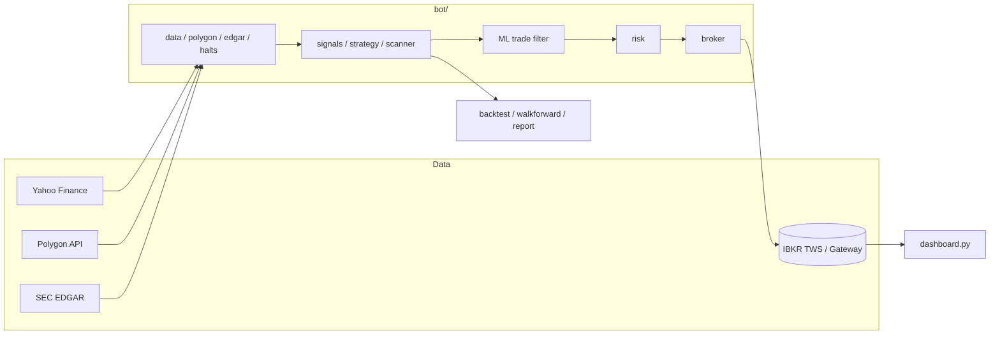

# IBKR Algo Trader

[](https://github.com/omarpatel/ibkr-algo-trader/actions/workflows/ci.yml)
[](LICENSE)


A Python research and paper-trading framework for Interactive Brokers, built around honest backtesting and hard risk limits.

## Overview

IBKR Algo Trader connects to an Interactive Brokers paper account through `ib_async` and runs a set of independent strategy "sleeves" (daily rotation, intraday, overnight, last-hour, small-cap momentum). Alongside the live bots sits a research toolkit: a cost-aware backtester that always compares against buy-and-hold, parameter sweeps, walk-forward validation, Monte Carlo bootstraps, event studies and an XGBoost trade filter with leakage tests. A local Flask dashboard reports equity, per-sleeve P&L and filter performance. Live trading is disabled by default and requires an explicit environment variable.

## Features

- **Backtesting** on synthetic demo data, Yahoo Finance daily bars or IBKR history, with a cost-stress mode (`run_backtest.py --stress`).
- **Evaluation tools**: parameter sweeps, walk-forward validation, Monte Carlo outcome distributions, strategy/symbol league tables with an HTML report.
- **Paper-trading bots** for daily, intraday, overnight and last-hour sleeves, plus small-cap scanners using Polygon data, SEC EDGAR filings and trading-halt feeds.
- **ML trade filter**: triple-barrier labels, walk-forward XGBoost training and a cost-charged backtest of the filter's picks.
- **Risk controls** in `bot/risk.py`, a kill-switch file, a pre-registered evaluation gate (`gate_criteria.yaml`) and a watchdog process.
- **Dashboard** (`dashboard.py`): read-only Flask site on `localhost:8050`.
- **Optional AI analysis** via the Anthropic API when `ANTHROPIC_API_KEY` is set.
- **Windows deployment scripts** to register scheduled tasks on a VPS.

## Architecture



Each `run_*.py` script is a thin entry point over the shared `bot/` package; scheduled tasks on the host run them at fixed market times.

## Tech stack

Python 3.10+, ib_async, pandas, NumPy, yfinance, matplotlib, XGBoost, scikit-learn, statsmodels, Flask, PyYAML, Anthropic SDK (optional), pytest, PowerShell (deployment).

## Getting started

```bash
python -m venv .venv
.venv\Scripts\activate          # Windows; use `source .venv/bin/activate` elsewhere
pip install -r requirements.txt  # core; migrate/requirements.txt pins the full environment
python run_backtest.py           # demo data, no account needed
python run_backtest.py --source yahoo --symbol SPY
python run_walkforward.py --symbol SPY
```

Paper trading requires TWS or IB Gateway logged into a paper account with the API enabled (settings in `config.yaml` under `ib:`):

```bash
python run_live.py
python dashboard.py
```

Environment variables (see `.env.example`):

| Variable | Purpose |
| --- | --- |
| `ANTHROPIC_API_KEY` | Enables `bot/ai_analyst.py` |
| `POLYGON_API_KEY` | Polygon market data for small-cap tools |
| `SEC_USER_AGENT` | User-Agent sent to SEC EDGAR (SEC requires a contact) |
| `I_UNDERSTAND_LIVE_TRADING_RISKS` | Must be `yes` to connect to a live account |

Lint and tests (also run in CI on every push):

```bash
pip install -r requirements-dev.txt
ruff check .
pytest
```

## Project structure

```
bot/        core package: broker, data sources, signals, strategies, risk, backtest, ML
models/     trained trade-filter model and metadata
migrate/    VPS setup, update bundling and pinned requirements
tests/      pytest suite
run_*.py    entry points for backtests, research labs and live sleeves
config.yaml strategy parameters and risk limits
*.md        research notes and operating docs
```

## License

MIT — see [LICENSE](LICENSE). Not financial advice.
